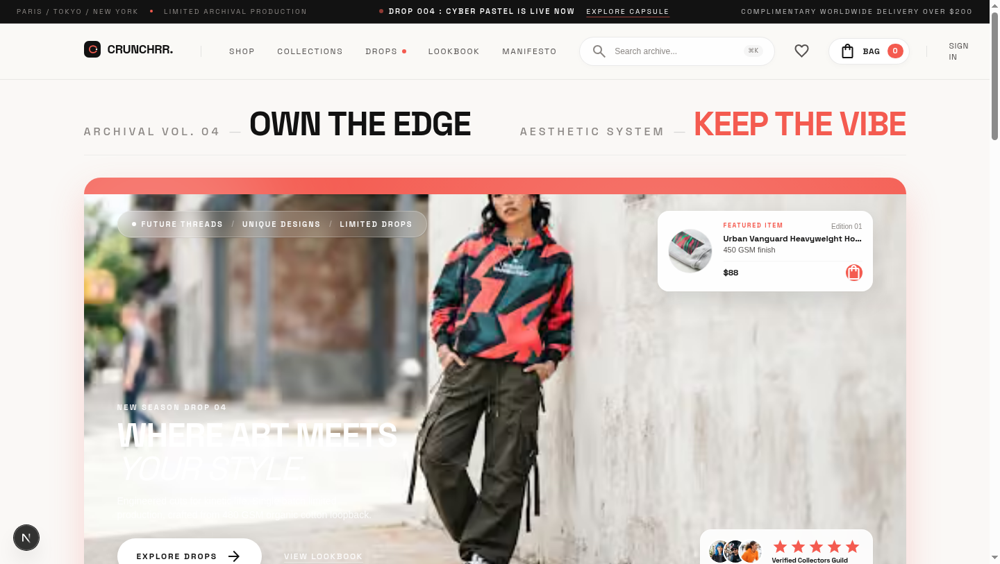

# CRUNCHRR.

High-contrast kinetic streetwear, powered by a multi-partner Print-on-Demand engine.
This repo is the full platform: a Next.js 15 storefront, a Fastify 5 commerce API,
Drizzle ORM on Neon Postgres, Clerk auth, Razorpay/Cashfree payments (with a
zero-credential demo mode), and Qikink/Printrove POD partner routing.



## Architecture

```
┌──────────────────────┐        ┌───────────────────────────┐
│  apps/web  (Next.js) │  CORS  │  apps/api  (Fastify 5)    │
│  :3001               │──────▶│  :4001                     │
│  React 19 · Tailwind │        │  zod · helmet · rate-limit│
│  Clerk · zustand bag │        │  Clerk auth · Drizzle ORM │
└──────────────────────┘        └────────────┬──────────────┘
                                             │
                       ┌─────────────────────┼─────────────────────┐
                       ▼                     ▼                     ▼
              ┌───────────────┐     ┌──────────────────┐   ┌───────────────┐
              │ Neon Postgres │     │ Payments          │   │ POD partners  │
              │ (Drizzle)     │     │ Razorpay·Cashfree │   │ Qikink·Printrove│
              └───────────────┘     │ + demo fallback   │   │ (+ simulated) │
                                    └──────────────────┘   └───────────────┘
```

**Monorepo layout** (pnpm workspaces, no turbo):

| Path | What |
| --- | --- |
| `apps/web` | Next.js 15.5 storefront (App Router, RSC) — home, shop, PDP with 3D customizer, bag/checkout, lookbook, drops, manifesto, auth |
| `apps/api` | Fastify 5 commerce API — catalog, checkout, payments, webhooks, POD dispatch |
| `packages/shared` | `@crunchrr/shared` — zod domain schemas, env loader, typed API client |

## Ports

| Service | Port |
| --- | --- |
| Web | **3001** (`pnpm --filter @crunchrr/web dev -p 3001`) |
| API | **4001** |

> Port 3000 is intentionally avoided (occupied by an unrelated local container).

## Quickstart

```bash
pnpm install

# 1. Env — copy real values into apps/api/.env and apps/web/.env.local
#    (see .env.example at the root for the full variable list)

# 2. Database — schema push + catalog seed (16 products / 80 SKUs)
pnpm db:push
pnpm db:seed

# 3. Run both servers
pnpm --filter @crunchrr/api dev   # API   → http://localhost:4001
pnpm --filter @crunchrr/web dev   # Store → http://localhost:3001
```

Health check: `curl localhost:4001/api/health` → `{"ok":true,"db":true}`

## API surface

| Method | Path | Purpose |
| --- | --- | --- |
| GET | `/api/health` | Liveness + DB ping |
| GET | `/api/products` | Catalog list (search/category/sort/pagination) |
| GET | `/api/products/:slug` | PDP payload (SKUs, colorways, cross-sell) |
| POST | `/api/orders/checkout` | Create order + payment intent (server-computed totals: promo → shipping → tax) |
| GET | `/api/orders/:id` | Order status (poll after payment) |
| POST | `/api/webhooks/razorpay` | Razorpay webhook (HMAC-SHA256 signature gate) |
| POST | `/api/webhooks/cashfree` | Cashfree webhook (SDK signature verification) |
| POST | `/api/orders/demo-confirm` | **Dev/demo only** — simulates a paid webhook, gated by `FORCE_DEMO_PAYMENTS` |
| * | `/api/admin/*` | Admin control plane (Clerk-gated, allowlisted users — see Admin panel section) |

## Demo payment flow (no gateway account needed)

With `FORCE_DEMO_PAYMENTS=true`, checkout returns a simulated payment intent and
the browser offers a **"Confirm payment (demo)"** button that calls
`POST /api/orders/demo-confirm` with the order id. That endpoint runs the exact
production path a real webhook would take:

```
payment confirmed → order marked PAYMENT_CONFIRMED
                  → order split per POD partner
                  → dispatched to Qikink / Printrove (or simulated adapter)
                  → split status ACCEPTED_BY_PARTNER / DISPATCHED
```

Idempotency: confirmations are safe to replay — repeat calls are no-ops.

## Admin panel (`/admin`)

Clerk-gated control plane for the shop — `requireAdmin` checks the session's
Clerk user id against `ADMIN_CLERK_USER_IDS` (add your Clerk user id there; in
development only, `ADMIN_DEV_BYPASS=true` skips the check).

| Page | What it does |
| --- | --- |
| Overview | KPIs (multi-currency revenue), 7-day USD-equivalent bars, low-stock watchlist, **live system-health strip (20s poll)** |
| Live Ops | Unified event feed — orders, webhooks, admin actions; 15s refresh |
| Analytics | FX-normalized margins, vendor scorecards, bestsellers, revenue by country, 7/30/90-day revenue chart |
| Orders | Search/status tabs, multi-currency totals; detail view with pieces, vendor routing, audit trail, restocking refunds |
| Fulfillment | Per-split dispatch / re-dispatch / retry-all-failed / mark shipped (optional tracking #) / delivered |
| Inventory | Every SKU: stock, vendor reassignment, inline restock, low-stock filter (≤5) |
| Products | Catalog list + editor: copy, variant matrix, per-variant vendor routing, create product, bulk discount/variants |
| Customers | Everyone who ordered, grouped by email, fx-normalized lifetime value |
| Partners | 11 POD vendors: credential editing (masked), live TEST ping (audited), per-vendor split stats + last activity/accept latency/last ping, network KPIs, live/simulated/paused filters, deep links into a vendor-filtered fulfillment queue |
| Countries | 19 shipping zones — currency, FX from USD, fees, free-ship threshold, tax, on/off, **market FX sync (drift-guarded)** |
| Promos | DB-driven percent-off codes with usage counts |
| Studio | Social composer for 6 platforms (posts + scheduled publishing) **and paid-campaign manager** |
| Team | Roles (OWNER/OPS/SUPPORT/PARTNER), vendor-login onboarding, append-only audit trail |
| Webhooks | Persist-first webhook audit with payload inspection |

### Multi-vendor partners

India/Tamil Nadu first, then the global (US/UK) platforms:

| Vendor | Base | Adapter |
| --- | --- | --- |
| Printrove | Coimbatore, Tamil Nadu | live (email → JWT → order push) |
| Inkmonk | Chennai, Tamil Nadu | rostered (simulated) |
| Qikink | Tirupati — TN/AP corridor | live (client_id + secret) |
| Blinkstore | Mumbai, India | rostered (simulated) |
| Printful | Charlotte, NC + UK/EU | rostered (simulated) |
| Printify | San Francisco, US/UK facilities | rostered (simulated) |
| Gelato | US/UK/EU lanes | rostered (simulated) |
| Contrado | London, England | rostered (simulated) |
| Inkthreadable | Lancashire, England | rostered (simulated) |
| Gooten | New York, USA | rostered (simulated) |
| In-House | own depot | manual |

Live adapters read credentials from the DB row (admin-editable) or env vars;
unconfigured partners dispatch in **simulation mode** so the fulfillment
pipeline keeps moving. Adding a live integration = one adapter file + one
registry row (`apps/api/src/services/partners/`).

### Multi-country money

Catalog prices live in **base USD minor units**. At checkout the zone row
converts every line (`fxFromUsd`), and fees, free-shipping thresholds and tax
are all in the **zone's own currency minor units**. Zone FX rates can be refreshed from the market: **Countries → Check market FX**
(preview) → **Apply live rates**. The API also refreshes them automatically
every `FX_REFRESH_HOURS` (default 12, `0` disables); per-currency drift over
±25% is refused and every applied change lands in the admin audit trail.

Zones shipped:
US · India · UK · Germany · France · Netherlands · Italy · Spain · Ireland ·
UAE · Saudi Arabia · Australia · Canada · Singapore · Malaysia · Hong Kong ·
Mexico · Brazil · South Africa. Add more from the Countries page (JPY/KRW-style
zero-decimal currencies are deliberately excluded — the money engine assumes
2-decimal minor units).

## Webhook security model

Built for zero-human-QA operation:

- **Raw body capture** — a custom `addContentTypeParser` stores `req.rawBody` so
  signature verification runs over the exact bytes received (no re-serialization drift).
- **Persist-first ingest** — every webhook is archived in `payment_webhooks`
  (payload + headers + outcome) *before* processing, via `onConflictDoNothing`,
  so invalid-signature replays can never overwrite the stored original.
- **Verification gate** — Razorpay verifies HMAC-SHA256 over the raw body with
  `RAZORPAY_WEBHOOK_SECRET`; Cashfree verifies with the official SDK.
- **Fail-safe outcomes** — invalid signature → `401 INVALID_SIGNATURE`;
  malformed JSON → `400`; unknown event type → `200 ignored`; unparseable
  envelope → `200 archived`. Processing errors never fail the delivery (200),
  the failure is recorded on the archived row instead.

### Manual webhook test (Razorpay)

```bash
# 1. Body — must be the exact bytes you send
cat > /tmp/rzp_body.json <<'EOF'
{"event":"payment.captured","payload":{"payment":{"entity":{"id":"pay_test123","order_id":"order_test123","amount":8800,"currency":"INR","notes":{"order_id":"<CR-ORDER-ID>"}}}}}
EOF

# 2. Sign the raw bytes
SIG=$(openssl dgst -sha256 -hmac "whsec_test_0102" < /tmp/rzp_body.json | awk '{print $2}')

# 3. Send
curl -s -X POST localhost:4001/api/webhooks/razorpay \
  -H "Content-Type: application/json" \
  -H "X-Razorpay-Signature: $SIG" \
  --data-binary @/tmp/rzp_body.json
```

Expected matrix (all verified end-to-end): valid sig + valid envelope →
`200 processed` · bad signature → `401 INVALID_SIGNATURE` · broken JSON →
`400` · unknown event → `200 ignored`. Every case lands in the
`payment_webhooks` audit table.

## Cart & checkout mechanics

- The bag is a **client-side zustand store** persisted to `localStorage`
  (`crunchrr-bag`) — instant UX, no server round-trips for cart mutations.
- Totals are **never trusted from the client**: checkout POSTs only the bag
  lines and address; the API recomputes promo discounts, shipping thresholds,
  and tax, then stores the authoritative totals.
- SKU format: `CR-<slugcode+hash>-<COLOR>-<SIZE>` with a deterministic hash
  suffix so catalog edits never collide.
- Orders split **per partner**: items route to the partner that fulfills each
  product (Qikink / Printrove), each split dispatched and tracked separately.

## UI fidelity

The storefront matches the Stitch mockups (drop header, coral hero, spotlight
card, filter rail, PDP colorway swatches + 3D view, bag express-checkout row).
Verified page captures live in `screenshots/`.

- `screenshots/home.png` — hero + drop countdown + social proof
- `screenshots/shop.png` — spotlight drop card + filter rail + catalog grid
- `screenshots/pdp.png` — trust marquee, thumbnails, colorway/size pickers
- `screenshots/bag.png` — secure checkout header + express wallets + bag state

## Stack

- **Web**: Next.js 15.5 · React 19 · Tailwind 3.4 · zustand · Clerk v6 ·
  three.js (R3F v9 + drei v10) · Space Grotesk / Plus Jakarta Sans ·
  Material Symbols
- **API**: Fastify 5 · Drizzle 0.44 (+ drizzle-kit) · postgres.js · zod ·
  @clerk/backend · razorpay · cashfree-pg
- **Infra**: Neon Postgres · pnpm workspaces

## Deploy

Step-by-step go-live for a one-person shop. The API ships as a container
(`Dockerfile` at the repo root) so it deploys unchanged to Fly.io, Railway,
Render, or a plain VPS; the web app deploys to Vercel.

### 1. Production data (Neon)

```bash
# Create the prod project in the Neon org, then push schema + seed to it.
# Inline DATABASE_URL wins over apps/api/.env (drizzle-kit reads process.env).
DATABASE_URL="postgres://<user>:<pw>@<prod-host>/crunchrr-shop?sslmode=require" \
  pnpm --filter @crunchrr/api db:push
DATABASE_URL="postgres://...same..." pnpm --filter @crunchrr/api db:seed
```

### 2. Web → Vercel

Import the repo, set **Root Directory = `apps/web`** (Next.js auto-detected).
Set these env vars *before* the first deploy — `NEXT_PUBLIC_*` values are
inlined at build time:

| Variable | Value |
| --- | --- |
| `NEXT_PUBLIC_API_URL` | `https://<api-domain>` |
| `API_INTERNAL_URL` | same as above (Vercel has no private network to the API) |
| `NEXT_PUBLIC_SITE_URL` | `https://<storefront-domain>` |
| `NEXT_PUBLIC_CLERK_PUBLISHABLE_KEY` | **live-instance** `pk_…` |
| `CLERK_SECRET_KEY` | **live-instance** `sk_…` |
| `NEXT_PUBLIC_CLERK_SIGN_IN_URL` | `/sign-in` (routing vars keep their defaults) |

### 3. API → Fly.io (example)

```bash
fly launch --dockerfile --no-deploy          # generate fly.toml from the Dockerfile
# fly.toml → [http_service] internal_port = 4001, checks path = "/api/health"
fly secrets set DATABASE_URL="postgres://…" \
  CLERK_SECRET_KEY="sk_…" CORS_ORIGINS="https://<storefront-domain>" \
  RAZORPAY_KEY_ID=… RAZORPAY_KEY_SECRET=… RAZORPAY_WEBHOOK_SECRET=… \
  CASHFREE_APP_ID=… CASHFREE_SECRET_KEY=… \
  QIKINK_CLIENT_ID=… QIKINK_CLIENT_SECRET=…
fly deploy
```

Railway/Render: create a service from the repo — the Dockerfile is detected
automatically; add the same variables in the dashboard. On any host set
`NODE_ENV=production`, leave `FORCE_DEMO_PAYMENTS` unset, and keep
`CORS_ORIGINS` limited to the storefront origin(s).

### 4. Clerk production instance

Create the **production instance** of `crunchrr-shop` in the Clerk dashboard,
copy its live `pk_`/`sk_` keys into Vercel (web) and the API host, and add the
storefront domain under **Allowed origins / redirects**. Keep the dev instance
for local work.

### 5. Payments: demo → real

- **Razorpay** — grab live keys, then create a webhook pointing at
  `https://<api-domain>/api/webhooks/razorpay` and subscribe it to
  `payment.captured`, `order.paid`, `payment.authorized`, `payment.failed`,
  `order.cancelled` (anything else is archived as `ignored`). The webhook
  secret becomes `RAZORPAY_WEBHOOK_SECRET`.
- **Cashfree** — real app credentials; webhook at
  `https://<api-domain>/api/webhooks/cashfree` (until configured, the route
  401s — intentional).
- **Partners** — replace the seeded Qikink/Printrove credential rows with real
  accounts (Drizzle Studio: `pnpm --filter @crunchrr/api db:studio`). Adapters
  fall back to simulation only when credentials are absent.
- Confirm `FORCE_DEMO_PAYMENTS=false`/unset — demo endpoints also self-disable
  when `NODE_ENV=production`.

### 6. Post-deploy smoke test (5 minutes)

1. `curl https://<api-domain>/api/health` → `{"status":"ok","db":true}`
2. Storefront loads products, `/robots.txt`, `/sitemap.xml`,
   `/opengraph-image` all render.
3. Sign in with Clerk on the prod domain; place one real order end-to-end and
   pay with a real method.
4. Verify the webhook landed (Razorpay dashboard + a row in the
   `payment_webhooks` audit table) and the partner split went
   `ACCEPTED_BY_PARTNER`.
5. Track the order by number on `/track`.

## Going live checklist

Everything above runs on demo/simulated credentials. For production, walk
through **Deploy** above, then verify:

1. **Razorpay** — live `RAZORPAY_KEY_ID/SECRET` + real `RAZORPAY_WEBHOOK_SECRET`
   from the dashboard webhook config; point the webhook at
   `https://<api-host>/api/webhooks/razorpay`.
2. **Cashfree** — real app credentials; its webhook verifier needs them (the
   Cashfree route currently 401s without credentials — intentional until an
   account exists).
3. **Qikink / Printrove** — real partner API credentials in the seeded
   partner-credential records; adapters fall back to simulation only when
   credentials are absent.
4. **Set `FORCE_DEMO_PAYMENTS=false`** (or unset) — demo endpoints disable
   themselves in production mode regardless.
5. **Clerk** — switch from test keys to the live instance.
6. **CORS_ORIGINS** — set to the production storefront origin(s) only.
